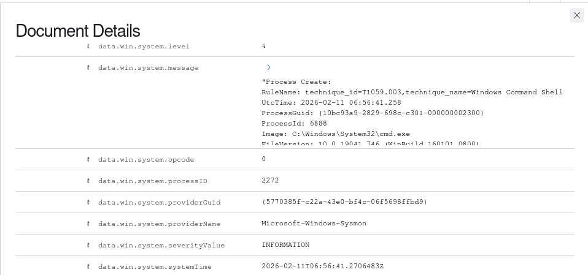
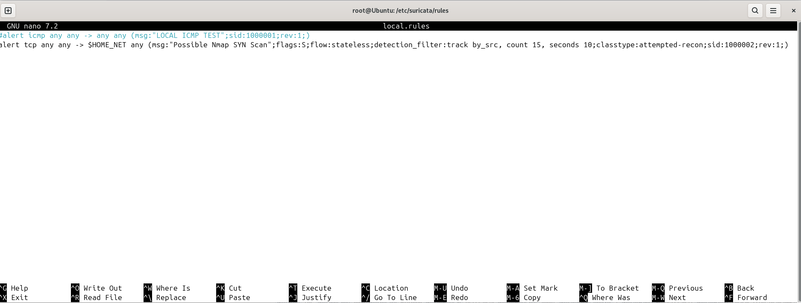
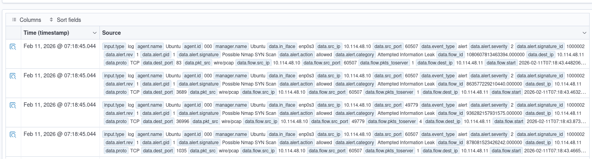

# Wazuh, Sysmon & Suricata – Security Monitoring Lab

## Overview

This project documents a hands-on security monitoring lab built to explore endpoint monitoring, network intrusion detection and centralised security event analysis.

The lab combined Wazuh SIEM, Microsoft Sysmon and Suricata IDS to collect and analyse security events from a Windows endpoint and detect suspicious network activity.

The environment was used to investigate how endpoint and network telemetry can be integrated into a centralised security monitoring solution.

**Note:** This is a completed historical lab. The original virtual machines and environment have since been decommissioned. The screenshots and documentation preserve evidence of the work performed.

## Objectives

- Deploy and configure a Wazuh security monitoring platform.
- Collect Windows endpoint telemetry using Sysmon and the Wazuh agent.
- Forward Suricata network intrusion detection alerts to Wazuh.
- Create and test a custom Suricata detection rule.
- Validate detection capabilities using controlled test activity.

## Lab Architecture

The lab consisted of the following components:

| Component | Role |
|---|---|
| Ubuntu Server | Hosted the Wazuh manager and Suricata |
| Windows 10 | Endpoint monitored by the Wazuh agent and Sysmon |
| Kali Linux | Used to generate controlled network test traffic |
| Wazuh | Centralised security event collection and analysis |
| Sysmon | Provided detailed Windows endpoint telemetry |
| Suricata | Network intrusion detection and alert generation |

The architecture connected endpoint and network monitoring components to Wazuh for centralised event visibility.

## Implementation

### 1. Wazuh Deployment

Deployed the Wazuh manager on Ubuntu and connected a Windows 10 endpoint using the Wazuh agent.

### 2. Windows Endpoint Monitoring with Sysmon

Installed Sysmon on the Windows endpoint and configured it using the Olaf Hartong Sysmon configuration.

Validated event collection by generating process creation activity, including launching `cmd.exe` from PowerShell, and confirming that the resulting telemetry was visible in Wazuh.

### 3. Suricata Integration

Installed and configured Suricata on the Ubuntu server.

Configured Suricata to monitor network traffic and generate alerts. Forwarded Suricata events through its `eve.json` output to Wazuh for centralised analysis.

### 4. Custom Detection Rule

Created a custom Suricata local rule to identify repeated TCP SYN traffic.

Tested the rule by running an Nmap SYN scan from Kali Linux against the Windows 10 endpoint.

Verified that the resulting Suricata alerts were received and displayed in Wazuh.

## Testing and Evidence

### 1. Windows Endpoint Monitoring – Sysmon

A process creation event was generated by launching `cmd.exe` from PowerShell on the Windows endpoint. The resulting Sysmon telemetry was collected by the Wazuh agent and displayed in the Wazuh dashboard.

### 2. Custom Detection Rule – Nmap SYN Scan

A custom Suricata rule was created to detect an Nmap SYN scan.

### 3. Suricata Network Alerts

Suricata was configured to monitor network traffic and forward generated alerts to Wazuh through its `eve.json` output. Custom rule alerts were monitored in Wazuh

## Key Learnings

- Gained practical experience deploying and configuring Wazuh.
- Learned how Sysmon provides detailed Windows endpoint telemetry.
- Integrated network intrusion detection events from Suricata into a SIEM platform.
- Developed and tested a custom Suricata detection rule.
- Validated detection results using controlled network activity.
- Explored how endpoint and network monitoring complement each other in security operations.

## Limitations

- The lab was designed for learning and experimentation, not production deployment.
- The custom detection rule was tested against controlled lab traffic and would require further tuning and validation before operational use.
- Detection effectiveness depends on the configured rules, telemetry sources and monitored network traffic.

## Disclaimer

This project was conducted in an isolated virtual lab environment using test systems and controlled activity. No production systems or third-party networks were targeted.

All screenshots are retained as historical evidence of the completed lab. The original environment is no longer operational.
