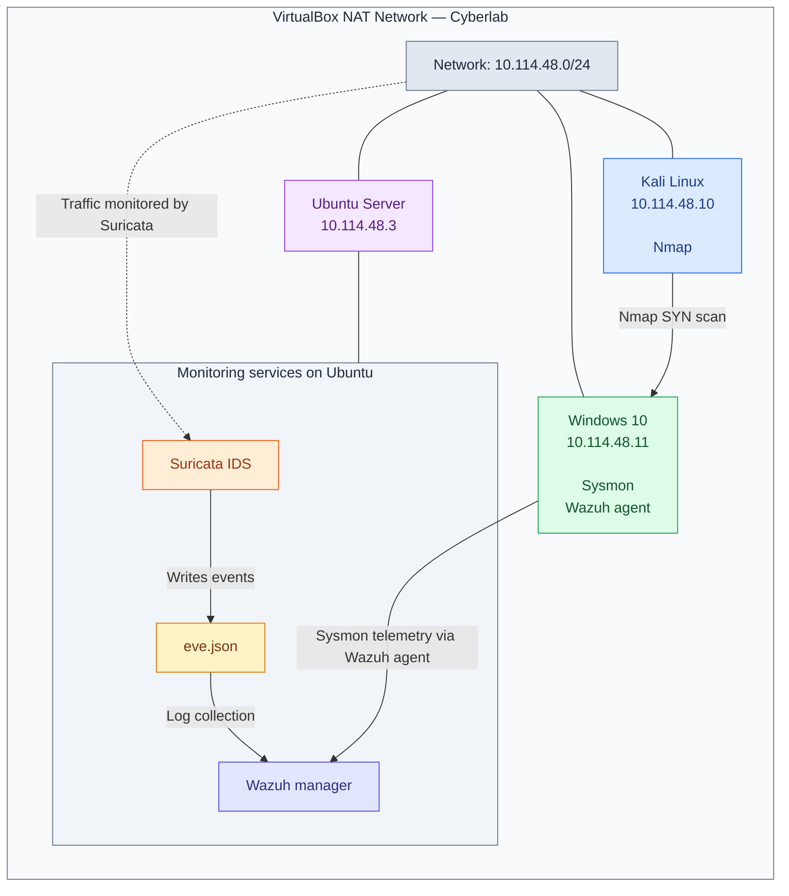

# Wazuh, Sysmon & Suricata – Security Monitoring Lab

## Overview

This project documents a hands-on security monitoring lab built to explore endpoint monitoring, network intrusion detection and centralised security event analysis.

The lab combined Wazuh SIEM, Microsoft Sysmon and Suricata IDS to collect and analyse security events from a Windows endpoint and detect suspicious network activity.

The environment was used to investigate how endpoint and network telemetry can be integrated into a centralised security monitoring solution.

**Note:** This is a completed historical lab. The original virtual machines and environment have since been decommissioned. The screenshots and documentation preserve evidence of the work performed.

## Objectives

- Deploy and configure a Wazuh security monitoring platform.
- Collect Windows endpoint telemetry using Sysmon and the Wazuh agent.
- Forward Suricata network intrusion detection alerts to Wazuh.
- Create and test a custom Suricata detection rule.
- Validate detection capabilities using controlled test activity.

## Lab Architecture

The virtual machines were connected through a VirtualBox NAT Network named **Cyberlab**, using the network range `10.114.48.0/24`.

| Machine | IP address | Role |
|---|---|---|
| Kali Linux | `10.114.48.10` | Network testing using Nmap |
| Windows 10 | `10.114.48.11` | Endpoint monitoring with Sysmon and Wazuh agent |
| Ubuntu Server | `10.114.48.3` | Wazuh manager and Suricata IDS |

## Implementation

### 1. Wazuh Deployment

Deployed the Wazuh manager on Ubuntu and connected a Windows 10 endpoint using the Wazuh agent.

### 2. Windows Endpoint Monitoring with Sysmon

Installed Sysmon on the Windows endpoint and configured it using the Olaf Hartong Sysmon configuration.

Validated event collection by generating process creation activity, including launching `cmd.exe` from PowerShell, and confirming that the resulting telemetry was visible in Wazuh.

### 3. Suricata Integration

Installed and configured Suricata on the Ubuntu server.

Configured Suricata to monitor network traffic and generate alerts. Forwarded Suricata events through its `eve.json` output to Wazuh for centralised analysis.

### 4. Custom Detection Rule

Created a custom Suricata local rule to identify repeated TCP SYN traffic.

Tested the rule by running an Nmap SYN scan from Kali Linux against the Windows 10 endpoint.

Verified that the resulting Suricata alerts were received and displayed in Wazuh.

## Testing and Evidence

### 1. Windows Endpoint Monitoring – Sysmon

A process creation event was generated by launching `cmd.exe` from PowerShell on the Windows endpoint. The resulting Sysmon telemetry was collected by the Wazuh agent and displayed in the Wazuh dashboard.

### 2. Custom Detection Rule – Nmap SYN Scan

A custom Suricata rule was created to detect an Nmap SYN scan.

### 3. Suricata Network Alerts

Suricata was configured to monitor network traffic and forward generated alerts to Wazuh through its `eve.json` output. Custom rule alerts were monitored in Wazuh

## Detection Analysis

The lab demonstrated how endpoint and network monitoring can complement each other to provide better visibility into security events.

Sysmon provided detailed telemetry about activity on the Windows endpoint, including process creation events. Suricata monitored network traffic and generated alerts for activity matching the custom detection rule. Wazuh collected and centralised these events, making them available for analysis through a single platform.

The Nmap SYN scan provided a controlled way to generate network activity and validate that the custom Suricata rule worked as expected. The resulting alerts confirmed that the detection events were successfully forwarded to and displayed in Wazuh.

This exercise highlighted the value of combining endpoint and network telemetry when monitoring and investigating potentially suspicious activity.

## Security Operations Perspective

From a security operations perspective, an alert should be treated as an indication that activity requires investigation rather than immediate confirmation of malicious behaviour.

When investigating a network alert, an analyst could:

- Review the source and destination IP addresses, timestamps and alert signature.
- Examine the relevant network activity to understand what triggered the detection.
- Check endpoint telemetry for related activity on the target system.
- Correlate events from different sources to build a clearer picture of what happened.
- Determine whether the activity is expected, suspicious or requires further investigation.

Correlating Suricata network alerts with Sysmon endpoint events can provide additional context that may not be available from either source alone.

## Limitations and Potential Improvements

The lab was designed to demonstrate basic endpoint monitoring, network intrusion detection and centralised event collection. It was not intended to represent a complete production security monitoring environment.

Some limitations and opportunities for further development include:

- **Detection coverage:** The custom Suricata rule was tested against a controlled Nmap SYN scan. Additional network activity and attack patterns would need to be tested to evaluate broader detection coverage.
- **False positives:** Legitimate network activity may trigger similar alerts. Detection rules would require further tuning and validation to reduce false positives.
- **Investigation workflow:** The lab focused on generating and collecting alerts rather than implementing a complete incident investigation and response process.
- **Event correlation:** Further development could explore more advanced correlation between network and endpoint events to improve investigation capabilities.
- **Detection validation:** Additional controlled tests could be used to evaluate the effectiveness and limitations of the configured detection rules.

These improvements would help develop the lab further towards a more comprehensive security monitoring and detection environment.

## Key Learnings

- Gained practical experience deploying and configuring Wazuh.
- Learned how Sysmon provides detailed Windows endpoint telemetry.
- Integrated network intrusion detection events from Suricata into a SIEM platform.
- Developed and tested a custom Suricata detection rule.
- Validated detection results using controlled network activity.
- Explored how endpoint and network monitoring complement each other in security operations.

## Disclaimer

This project was conducted in an isolated virtual lab environment using test systems and controlled activity. No production systems or third-party networks were targeted.

All screenshots are retained as historical evidence of the completed lab. The original environment is no longer operational.
